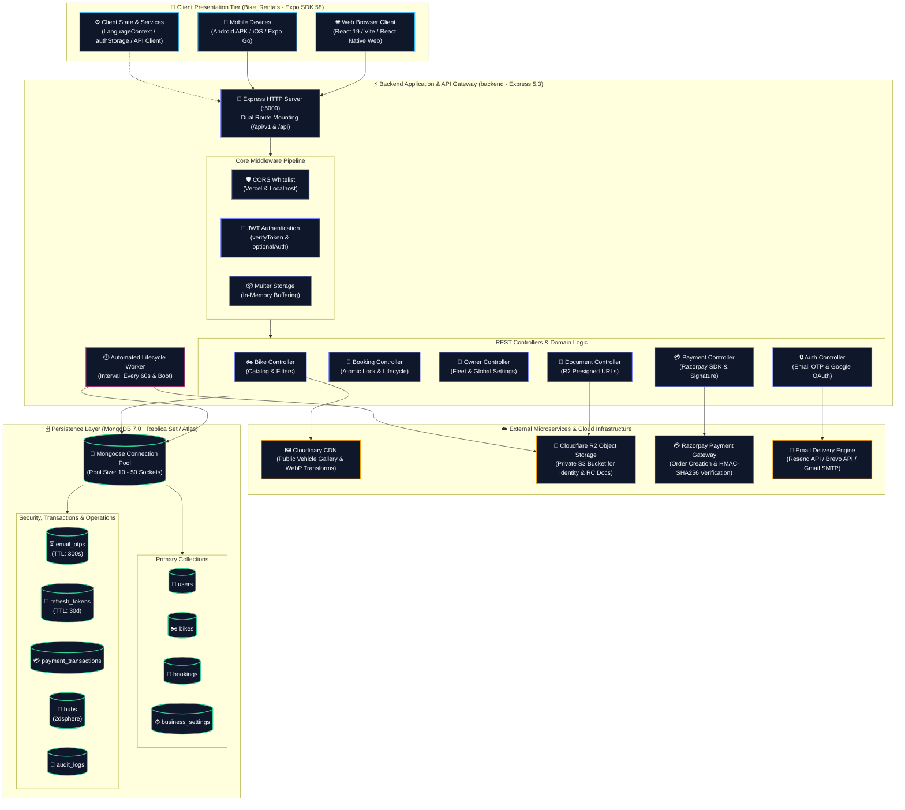
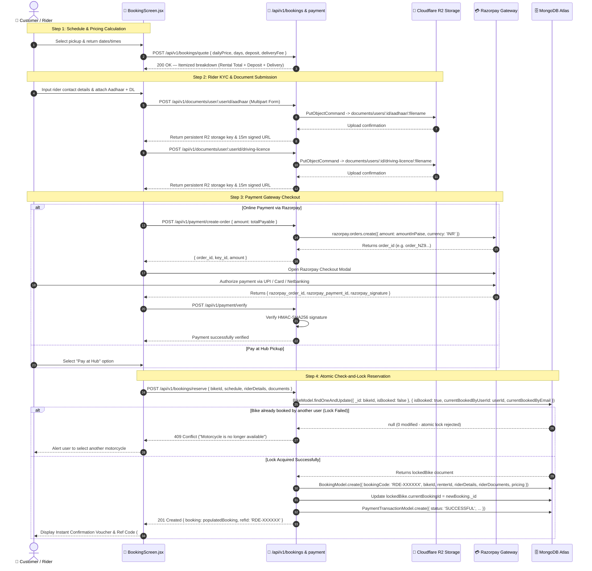
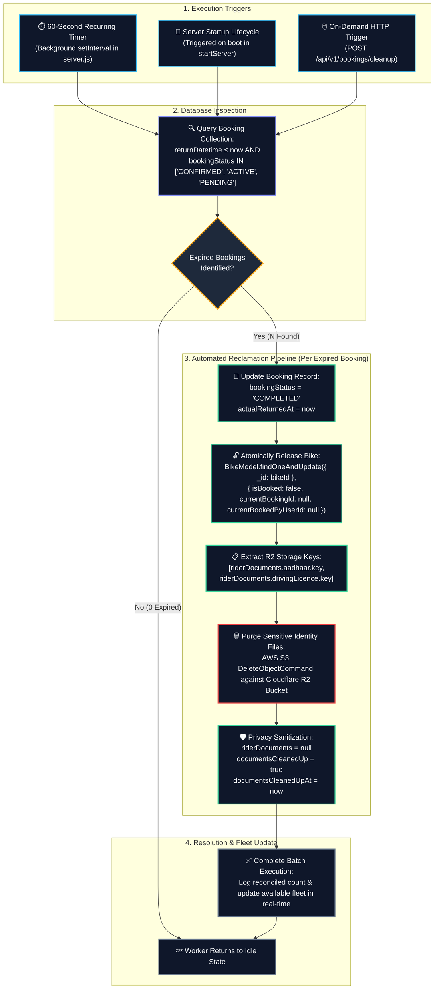
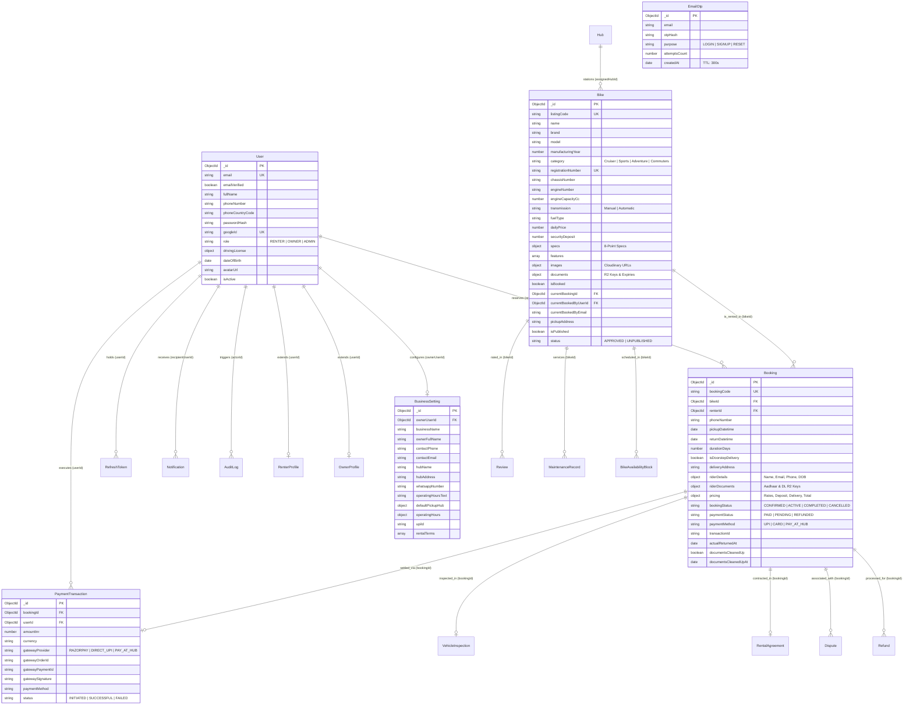
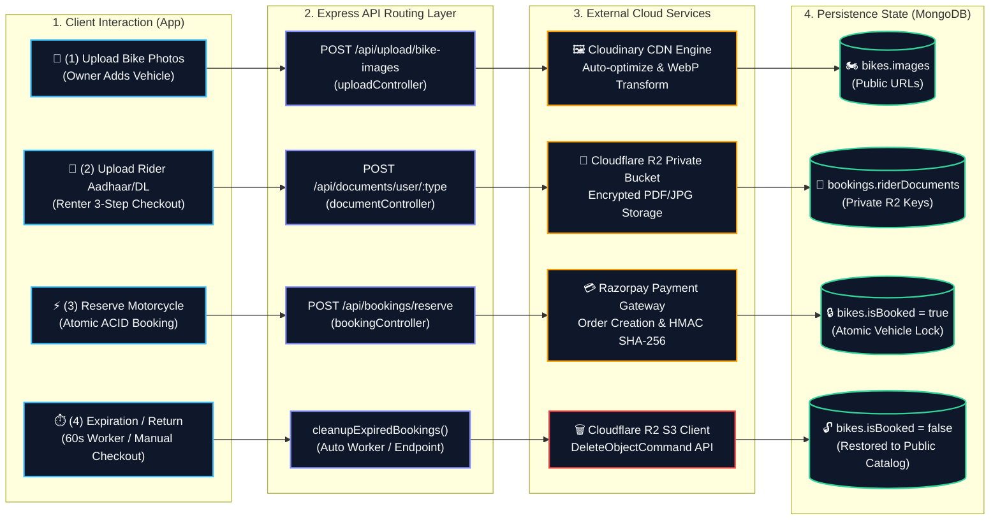
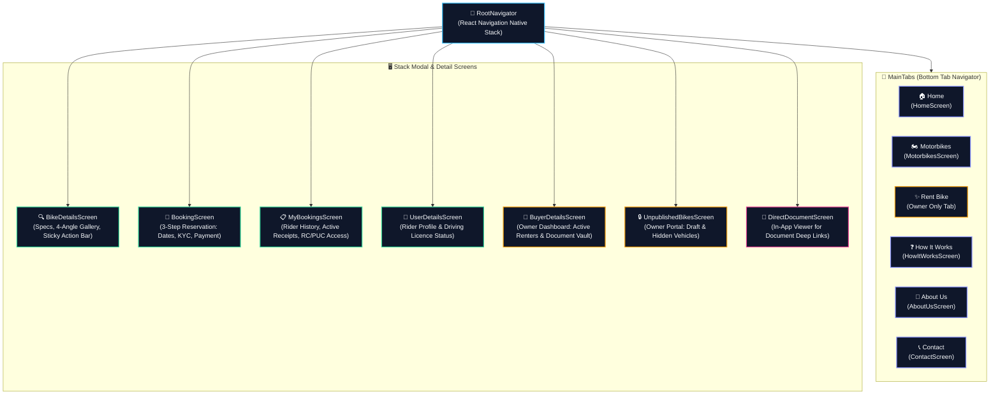

# 🏍️ The Road Eagle (BikeTS) — Complete Implementation & Architecture Guide

A production-grade, full-stack **Single-Owner Motorcycle Fleet Rental Platform** built with **Node.js, Express.js, MongoDB (Mongoose), Cloudinary, Cloudflare R2, Razorpay**, and a cross-platform **React Native (Expo SDK 58)** client for Web, Android, and iOS.

---

## 📑 Table of Contents

1. [Project Overview & Business Model](#-project-overview--business-model)
2. [Complete System Architecture](#-complete-system-architecture)
   - [High-Level Architecture Diagram](#high-level-architecture-diagram)
   - [Architectural Design Principles](#architectural-design-principles)
3. [End-to-End Application Workflow](#-end-to-end-application-workflow)
   - [User Roles & Permissions](#user-roles--permissions)
   - [Dynamic Fleet Visibility Flow](#dynamic-fleet-visibility-flow)
   - [Reservation & Atomic Lock Workflow](#reservation--atomic-lock-workflow)
   - [Automated Lifecycle & Document Cleanup](#automated-lifecycle--document-cleanup)
4. [Complete Database Architecture & Data Flow](#-complete-database-architecture--data-flow)
   - [Database Technology & Connection Management](#database-technology--connection-management)
   - [Entity-Relationship Diagram (ERD)](#entity-relationship-diagram-erd)
   - [Mongoose Schemas & Model Reference](#mongoose-schemas--model-reference)
   - [CRUD Operations & Service Flow](#crud-operations--service-flow)
   - [Data Flow: Frontend to Storage & External Services](#data-flow-frontend-to-storage--external-services)
5. [Authentication, Authorization & Security Flow](#-authentication-authorization--security-flow)
   - [Email OTP Flow with TTL Index](#email-otp-flow-with-ttl-index)
   - [Google OAuth Exchange](#google-oauth-exchange)
   - [JWT & Refresh Token Architecture](#jwt--refresh-token-architecture)
   - [Role-Based Access Control (RBAC)](#role-based-access-control-rbac)
6. [API & Route Reference](#-api--route-reference)
   - [Base Configuration & Endpoints](#base-configuration--endpoints)
   - [Detailed Route Mapping](#detailed-route-mapping)
7. [Frontend Application Architecture](#-frontend-application-architecture)
   - [Navigation Architecture](#navigation-architecture)
   - [Screen Modules & Responsibilities](#screen-modules--responsibilities)
   - [Component Hierarchy & Features](#component-hierarchy--features)
   - [Internationalization (i18n)](#internationalization-i18n)
8. [Storage & External Services](#-storage--external-services)
   - [Cloudinary (Public Vehicle Imagery)](#cloudinary-public-vehicle-imagery)
   - [Cloudflare R2 Storage (Confidential Documents)](#cloudflare-r2-storage-confidential-documents)
   - [Razorpay Payment Gateway](#razorpay-payment-gateway)
   - [Email Delivery (Brevo / Resend / Nodemailer)](#email-delivery-brevo--resend--nodemailer)
9. [Environment Variables & Configuration](#-environment-variables--configuration)
10. [Directory & File Structure](#-directory--file-structure)
11. [Installation, Setup & Execution](#-installation-setup--execution)
    - [Prerequisites](#prerequisites)
    - [Backend Setup & Execution](#backend-setup--execution)
    - [Frontend Setup & Execution](#frontend-setup--execution)
    - [Maintenance & Diagnostic Scripts](#maintenance--diagnostic-scripts)
12. [Implementation Verification Status](#-implementation-verification-status)

---

## 🎯 Project Overview & Business Model

**The Road Eagle** is an enterprise-grade motorcycle and scooter rental solution designed around a **Single-Owner Direct Fleet Operator Model** (eliminating Peer-to-Peer marketplace complexity, host commissions, and multi-tenant payouts).

### Core Business Model Features
- **Direct Single Fleet Operator:** Only the business owner has permission to upload, price, update, unpublish, and delete motorcycles. Regular users cannot list personal vehicles.
- **Single-Entry Business Profile:** Owner and Hub contact information (address, phone numbers, WhatsApp concierge, operating hours, and UPI ID) are stored **once** in a centralized database record (`BusinessSetting`) and shared globally across the fleet.
- **Conditional Vehicle Visibility:**
  - **Available Vehicles:** Visible to all guests, registered riders, and the owner.
  - **Vehicle Booked by Current User:** Displayed with a dimmed card styling and a prominent `"BOOKED BY YOU"` badge. Clicking opens the booking confirmation voucher, itemized receipt, and pickup checklist.
  - **Vehicle Booked by Another User:** Completely hidden from public catalog queries to prevent double-booking attempts and UI clutter.
  - **Owner View:** The owner sees the entire fleet (both available and booked). On booked bikes, the owner can view full renter identity, contact information, rental dates, and uploaded identity documents.
- **Confidential Document Privacy & Auto-Purge:** User identity documents (Aadhaar, Driving Licence) and vehicle compliance files (RC Smart Card, Insurance, PUC) are stored securely in **Cloudflare R2** private object storage. Users access them via short-lived (15-minute) presigned URLs. Once a rental period expires or a bike is marked returned, sensitive user identity documents are automatically purged from R2 storage.

---

## 🏗️ Complete System Architecture

### High-Level Architecture Diagram



### Architectural Design Principles
1. **Zero External Cache or Message Queue:** BullMQ and Redis are intentionally **not required**. MongoDB natively handles OTP expiration via a native **TTL index** (`expires: 300`), atomic concurrency using `findOneAndUpdate`, and session timeouts via refresh token TTL indexes (`expires: 2592000`).
2. **Dual-Path REST Routing:** All controllers are dual-mounted under both `/api/v1/*` and `/api/*` for backward compatibility across web, local development, and mobile clients.
3. **Decoupled Public vs. Private Media Storage:**
   - **Public Media:** Motorcycle photos (front, rear, left, right, thumbnail) are hosted on **Cloudinary** with automated WebP format and width constraints (`w_1200,c_limit,q_auto,f_auto`).
   - **Confidential Media:** Rider Aadhaar cards, driving licences, and vehicle registration/insurance certificates are stored in **Cloudflare R2** private buckets. Access is mediated strictly via temporary AWS S3 presigned URLs (900 seconds validity) generated on-the-fly by the backend.
4. **ACID-Compliant Double-Booking Prevention:** Double-booking is prevented at the database driver level using MongoDB atomic filter-and-mutate execution.

---

## 🔄 End-to-End Application Workflow

### User Roles & Permissions

| Role | Definition & Assignment | Capabilities |
|---|---|---|
| **`RENTER`** | Default role assigned upon email OTP or Google signup. | Browse available fleet, view technical specifications, initiate 3-step reservations, upload KYC documents (Aadhaar & DL), complete payments, view personal active/past booking receipts, and access bike documents during active rentals. |
| **`OWNER`** | Assigned automatically if user email matches `OWNER_EMAIL` in backend `.env` (`gamedevelop06@gmail.com`) or `EXPO_PUBLIC_OWNER_EMAIL` in frontend `.env`. | Add new motorcycles via 4-step wizard, edit fleet specs, upload RC/Insurance/PUC documents, toggle publish/unpublish status, delete vehicles, configure global business & hub settings, access the Owner Dashboard with live buyer details & timelines, and verify submitted rider documents. |
| **`ADMIN`** | Assigned to system management accounts. | System audit logs, platform KPI metrics, ticket arbitration, manual refunds, and user account status moderation. |

---

### Dynamic Fleet Visibility Flow

When querying the motorcycle catalog (`GET /api/v1/bikes`), the query layer enforces strict privacy and availability rules:

```mermaid
sequenceDiagram
    autonumber
    actor Guest as 🌐 Unauthenticated Rider
    actor Renter as 👤 Logged-In Rider
    actor Owner as 👑 Fleet Owner
    participant API as 🚀 /api/v1/bikes (bikeController)
    participant DB as 🗄️ MongoDB (Bike & Booking Collections)

    rect rgb(15, 23, 42)
        Note over Guest,DB: Scenario A: Guest / Unauthenticated Browsing
        Guest->>API: GET /api/v1/bikes (No Token)
        API->>DB: find({ isBooked: false, isPublished: { $ne: false }, status: { $ne: 'UNPUBLISHED' } })
        DB-->>API: Returns only unbooked & published vehicles
        API-->>Guest: 200 OK — Clean catalog of available motorcycles
    end

    rect rgb(20, 30, 55)
        Note over Renter,DB: Scenario B: Logged-In Customer Viewing Fleet
        Renter->>API: GET /api/v1/bikes (Bearer JWT / user identifier)
        API->>DB: find({ $and: [ { isPublished: true }, { $or: [ { isBooked: false }, { isBooked: true, currentBookedByUserId: userId } ] } ] })
        DB-->>API: Returns available fleet + bikes booked by this specific rider
        API->>API: Tag user's vehicle with isMyBooking = true
        API-->>Renter: 200 OK — Available fleet + Dimmed "BOOKED BY YOU" cards (Opens Voucher)
    end

    rect rgb(30, 20, 45)
        Note over Owner,DB: Scenario C: Fleet Owner Accessing Inventory
        Owner->>API: GET /api/v1/bikes (Owner JWT: OWNER role)
        API->>DB: find({}) with .populate('currentBookingId') & .populate('renterId')
        DB-->>API: Returns 100% of fleet (Available, Booked, and Unpublished drafts)
        API->>API: Auto-reconcile orphaned bookings (if booking missing in DB)
        API-->>Owner: 200 OK — Complete inventory + Renter details & document verification triggers
    end
```



---

### Reservation & Atomic Lock Workflow

The reservation pipeline executes with strict ACID guarantees to prevent concurrent double-booking:



---

### Automated Lifecycle & Document Cleanup

An automated background cleanup engine runs on a 60-second recurring timer (`server.js`) and also executes on server startup and before dashboard loads:



---

## 🗄️ Complete Database Architecture & Data Flow

### Database Technology & Connection Management

- **Database Engine:** MongoDB 7.0+ (MongoDB Atlas / Replica Set).
- **Object Data Modeling (ODM):** Mongoose v9.12.0.
- **Connection Configuration (`backend/src/config/db.js`):**
  - Configured with `minPoolSize: 10`, `maxPoolSize: 50` for high concurrency.
  - Server selection timeout: `10,000 ms`.
  - Socket timeout: `45,000 ms`.
  - Explicit database name resolution: `process.env.MONGODB_DB_NAME || 'bike'`.
  - Event listeners on `connected`, `error`, `disconnected` states.
  - Graceful connection termination on `SIGINT` and `SIGTERM` OS signals.
  - **Offline-Resilient Startup:** If the remote MongoDB cluster is unreachable during initial startup, the Express API starts in offline-resilient mode, serving static endpoints and logging informative diagnostics rather than crashing.

---

### Entity-Relationship Diagram (ERD)



---

### Mongoose Schemas & Model Reference

The backend defines **19 distinct Mongoose models** located under `backend/src/models/`:

#### 1. `User` (`User.js`)
- **Primary Fields:** `email` (unique, lowercase), `emailVerified` (bool), `fullName` (trimmed), `phoneNumber`/`phone`/`phone_number` (aliased in pre-save hook), `phoneCountryCode` (default `+91`), `passwordHash` (`select: false`), `googleId` (sparse unique), `role` (`RENTER`, `OWNER`, `ADMIN`), `drivingLicense` (sub-doc with `dlNumber`, `dlExpiryDate`, `dlClass`, `isVerified`), `dateOfBirth` (Date), `avatarUrl` (String), `isActive` (Boolean).
- **Virtuals & Hooks:** Virtual `name` returns `fullName`. Pre-save hook synchronizes `phone`, `phoneNumber`, and `phone_number`.

#### 2. `EmailOtp` (`EmailOtp.js`)
- **Primary Fields:** `email` (indexed), `otpHash` (bcrypt hash), `purpose` (`LOGIN`, `SIGNUP`, `PASSWORD_RESET`, `EMAIL_VERIFICATION`), `attemptsCount` (default 0, max 3), `createdAt` (Date).
- **TTL Index:** `createdAt` has `{ expires: 300 }` — MongoDB natively removes records after 300 seconds (5 minutes).

#### 3. `Bike` (`Bike.js`)
- **Primary Fields:** `name`, `brand`, `model`, `manufacturingYear`, `category` (`Cruiser Bikes`, `Sports & Track`, `Adventure Tourer`, `Scooters & Commuters`), `registrationNumber` (unique uppercase), `chassisNumber`, `engineNumber`, `engineCapacityCc`, `transmission` (`Manual`, `Automatic`), `fuelType` (default `Petrol`), `color`, `tagline`, `dailyPrice`, `securityDeposit`, `specs` (8-point subdocument), `features` (array of strings), `images`/`photos` (front, rear, left, right, thumbnail), `gallery` (array of image URLs), `documents` (`rcSmartCardUrl`, `insurancePolicyUrl`, `insuranceExpiryDate`, `pucCertificateUrl`, `pucExpiryDate`), `isBooked` (bool), `currentBookingId` (ref `Booking`), `currentBookedByUserId` (ref `User`), `currentBookedByEmail`, `pickupAddress`, `pickupTimings`, `doorstepDeliveryAvailable`, `doorstepDeliveryFee`, `isFeatured`, `isPublished` (bool), `rating` (default 5.0), `reviewsCount`, `status` (default `APPROVED`), `listingCode` (unique e.g. `RDE-XXXXXX`).
- **Indexes:** Compound index `{ brand: 'text', model: 'text', category: 'text', pickupAddress: 'text' }`, compound index `{ isBooked: 1, category: 1, dailyPrice: 1 }`.

#### 4. `Booking` (`Booking.js`)
- **Primary Fields:** `bookingCode`/`booking_code` (unique e.g. `RDE-891024`), `bikeId` (ref `Bike`), `renterId` (ref `User`), `phoneNumber`/`phone`/`phone_number`, `pickupDatetime`, `returnDatetime`, `durationDays`, `isDoorstepDelivery`, `deliveryAddress`, `riderDetails` (`fullName`, `email`, `phoneNumber`, `dateOfBirth`, `documents`), `riderDocuments` (`aadhaar`, `drivingLicence`), `pricing` (`dailyRate`, `rentalTotal`, `securityDeposit`, `deliveryFee`, `totalPayable`), `bookingStatus` (`CONFIRMED`, `ACTIVE`, `COMPLETED`, `CANCELLED`), `paymentStatus` (`PAID`, `PENDING`, `REFUNDED`), `paymentMethod` (`UPI`, `CREDIT_CARD`, `DEBIT_CARD`, `PAY_AT_HUB`), `transactionId`, `actualPickupAt`, `actualReturnedAt`, `documentsCleanedUp` (bool), `documentsCleanedUpAt` (Date).
- **Indexes:** Compound index `{ bikeId: 1, bookingStatus: 1, pickupDatetime: 1, returnDatetime: 1 }`.

#### 5. `BusinessSetting` (`BusinessSetting.js`)
- **Primary Fields:** `ownerUserId` (ref `User`), `businessName` (default `The Road Eagle`), `ownerFullName`, `contactPhone`, `contactEmail`, `emergencyPhone`, `hubName`, `hubAddress`, `mapUrl`, `whatsappNumber`, `operatingHoursText`, `operatingHoursSubtext`, `emailResponseTime`, `defaultPickupHub` (`name`, `address`, `city`, `state`, `pincode`), `operatingHours` (`openTime`, `closeTime`), `upiId`, `bankDetails` (`accountNumber`, `ifscCode`, `bankName`), `rentalTerms` (string array).

#### 6. `PaymentTransaction` (`PaymentTransaction.js`)
- **Primary Fields:** `bookingId` (ref `Booking`), `userId` (ref `User`), `amountInr`, `currency` (default `INR`), `gatewayProvider` (`RAZORPAY`, `STRIPE`, `CASHFREE`, `PAY_AT_HUB`, `DIRECT_UPI`), `gatewayOrderId`, `gatewayPaymentId`, `gatewaySignature`, `paymentMethod` (`UPI`, `CREDIT_CARD`, `DEBIT_CARD`, `NETBANKING`, `CASH`), `status` (`INITIATED`, `PENDING`, `SUCCESSFUL`, `FAILED`, `USER_DROPPED`), `webhookReceived`, `errorCode`, `errorDescription`, `idempotencyKey` (sparse unique).

#### 7. `Hub` (`Hub.js`)
- **Primary Fields:** `city`, `hubName`, `address`, `pincode`, `location` (GeoJSON Point: `coordinates: [longitude, latitude]`), `openingTime`, `closingTime`, `contactPhone`, `isActive`.
- **Indexes:** 2dsphere spatial index on `location`.

#### 8. `Review` (`Review.js`)
- **Primary Fields:** `bookingId` (unique ref `Booking`), `bikeId` (ref `Bike`), `renterId` (ref `RenterProfile`), `ownerId` (ref `OwnerProfile`), `reviewType` (`RENTER_TO_BIKE`, `RENTER_TO_OWNER`, `OWNER_TO_RENTER`), `rating` (1-5), `cleanlinessScore`, `enginePerformanceScore`, `communicationScore`, `comment`, `reviewPhotos`, `ownerReply`, `isApproved`.

#### 9. `VehicleInspection` (`VehicleInspection.js`)
- **Primary Fields:** `bookingId` (ref `Booking`), `inspectionType` (`PICKUP`, `RETURN`), `odometerReadingKm`, `fuelPercentage` (0-100), `bodyScratchesDescription`, `scratchMarkers` (array of panel, severity, xRatio, yRatio), `photos` (array), `signedByRenter`, `signedByExecutiveOrOwner`, `inspectionTimestamp`.
- **Indexes:** Compound unique index `{ bookingId: 1, inspectionType: 1 }`.

#### 10. `RefreshToken` (`RefreshToken.js`)
- **Primary Fields:** `userId` (ref `User`), `tokenHash`, `expiresAt`, `ipAddress`, `userAgent`, `isRevoked`, `createdAt`.
- **TTL Index:** `createdAt` has `{ expires: 2592000 }` (30-day auto-expiry).

#### 11. `AuditLog` (`AuditLog.js`)
- **Primary Fields:** `actorId` (ref `User`), `actorRole` (`ADMIN`, `SUPERADMIN`, `SUPPORT`, `SYSTEM_CRON`), `action` (enumeration of admin/system actions), `targetEntityType` (`USER`, `BIKE`, `BOOKING`, `REFUND`, `DISPUTE`, `SETTINGS`), `targetEntityId`, `beforeSnapshot`, `afterSnapshot`, `adminNotes`, `ipAddress`, `userAgent`, `timestamp`.

#### 12-19. Additional Schema Suite
- `OwnerProfile.js`: Host verification, encrypted bank details, PAN, and KYC states.
- `RenterProfile.js`: Driver's licence compliance, age verification (18+ validator), KYC status.
- `Dispute.js`: Damage claims, late return disputes, arbitration records, deposit deduction tracking.
- `SupportTicket.js`: Customer support ticketing, categories, priorities, admin assignment.
- `Notification.js`: System, booking, and alert notifications with deep link screens.
- `PlatformSetting.js`: Key-value configuration store for fees and system parameters.
- `Refund.js`: Security deposit refunds and payment reversals.
- `RentalAgreement.js`: Digital rental agreements, SHA-256 content hashes, IP address signatures.
- `BikeAvailabilityBlock.js`: Calendar maintenance blocks for vehicles.
- `MaintenanceRecord.js`: Workshop service logs, odometer readings, invoices, and parts replaced.

---

### CRUD Operations & Service Flow

| Resource | Create (C) | Read (R) | Update (U) | Delete (D) |
|---|---|---|---|---|
| **Users** | `POST /auth/email-otp/verify` (Upsert on OTP verify) or `POST /auth/google` | `GET /auth/me`, `GET /auth/check-user`, `GET /auth/user/:id` | `POST /auth/email-otp/verify` (Updates name/phone) | Handled via admin audit controls (`AuditLog`) |
| **Fleet Bikes** | `POST /api/v1/owner/bikes` or `POST /api/v1/bikes` | `GET /api/v1/bikes` (conditional query), `GET /api/v1/bikes/:id` | `PUT /api/v1/owner/bikes/:id`, `PATCH /api/v1/bikes/:id` | `DELETE /api/v1/owner/bikes/:id` (cleans associated Cloudinary photos) |
| **Bookings** | `POST /api/v1/bookings/reserve` (Atomic check & lock) | `GET /api/v1/bookings`, `GET /api/v1/bookings/:id`, `GET /api/v1/bookings/my-bookings`, `GET /api/v1/bookings/owner-dashboard` | `PATCH /api/v1/bookings/:id/status`, `POST /api/v1/bookings/:id/return` | `POST /api/v1/bookings/:id/cancel` (releases vehicle) |
| **Business Settings** | Created on startup seed or auto-initialized on first fetch | `GET /api/v1/settings` or `GET /api/v1/owner/settings` | `PUT /api/v1/owner/settings` (upserts single company record) | Not applicable (persistent singleton configuration) |
| **Documents** | `POST /api/v1/documents/user/:documentType`, `POST /api/v1/documents/bike/:documentType` | `GET /api/v1/documents/open`, `GET /api/v1/documents/file/:bikeId/:docType`, `GET /api/v1/documents/signed-url` | Overwrite key in R2 with updated buffer | `DELETE /api/v1/documents` (Deletes object from Cloudflare R2 bucket) |
| **Payments** | `POST /api/v1/payment/create-order` | Gateway callback / `POST /api/v1/payment/verify` | Updates `paymentStatus: 'PAID'` on `Booking` and `PaymentTransaction` | Managed via `Refund` schema on cancellation |

---

### Data Flow: Frontend to Storage & External Services



---

## 🔐 Authentication, Authorization & Security Flow

### Email OTP Flow with TTL Index

1. **Dispatch (`POST /api/v1/auth/email-otp/send`):**
   - Generates a secure random 6-digit numeric OTP (`Math.floor(100000 + Math.random() * 900000)`).
   - Hashes the OTP using `bcrypt.hash(rawOtp, 8)`.
   - Deletes any existing pending OTPs for that email address.
   - Saves record into `email_otps` with `createdAt: new Date()` (auto-expires in 300 seconds via MongoDB TTL index).
   - Dispatches HTML formatted verification email using the multi-transport mail sender.
2. **Verification (`POST /api/v1/auth/email-otp/verify`):**
   - Compares candidate code against stored bcrypt hash (supports dev demo codes `1234` / `123456`).
   - Increments `attemptsCount`; rejects if attempts $\ge 3$.
   - Automatically registers the user if they do not yet exist, or updates their profile if existing.
   - Issues a JSON Web Token (JWT) and generates a cryptographic 40-byte hex refresh token.

### Google OAuth Exchange

- Endpoint: `POST /api/v1/auth/google`.
- The client initiates OAuth using `expo-auth-session` / `expo-crypto` / `WebBrowser`.
- On receiving authentication credentials, the client passes `email`, `fullName`, `googleId`, and `avatarUrl` to the backend.
- The backend matches on `{ $or: [{ email }, { googleId }] }`, creates or updates the user account, verifies `emailVerified = true`, and returns JWT access and refresh tokens.

### JWT & Refresh Token Architecture

- **Access Token:** Signed using `JWT_ACCESS_SECRET` with HS256 algorithm; default expiry `15m` (`JWT_EXPIRES_IN`).
- **Payload:** `{ id: user._id, email: user.email, role: user.role }`.
- **Refresh Token:** Cryptographically random 40-byte hex string; hashed with bcrypt and stored in the `refresh_tokens` collection with a 30-day TTL expiration index (`expires: 2592000`).

### Role-Based Access Control (RBAC)

- Handled in `backend/src/middleware/auth.js`:
  - `verifyToken`: Extracts Bearer token, verifies signature, verifies that the user exists and is active (`isActive: true`), checks if the email matches `OWNER_EMAIL`, and binds `req.user`.
  - `optionalAuth`: Same verification, but gracefully permits unauthenticated requests without throwing 401 errors.
  - `requireRole(...roles)`: Enforces that `req.user.role` is included in the authorized whitelist; returns `403 Forbidden` if unauthorized.

---

## 📡 API & Route Reference

### Base Configuration & Endpoints

- **Root Status Endpoint:** `GET /`
  ```json
  {
    "name": "The Road Eagle (Bike_Rentals) API",
    "version": "1.0.0",
    "status": "ONLINE",
    "dbState": "CONNECTED",
    "modelsCount": 11,
    "timestamp": "2026-11-20T12:00:00.000Z"
  }
  ```
- **Health Check Endpoint:** `GET /health`
  ```json
  {
    "status": "HEALTHY",
    "database": {
      "connected": true,
      "name": "bike",
      "host": "cluster0.mongodb.net",
      "readyState": 1
    },
    "uptimeSeconds": 3600,
    "timestamp": "2026-11-20T12:00:00.000Z"
  }
  ```

### Detailed Route Mapping

All endpoints are mounted on both `/api/v1` and `/api`.

#### 1. Authentication Routes (`/auth`)
| Method | Endpoint | Auth Level | Description |
|---|---|---|---|
| `POST` | `/api/v1/auth/email-otp/send` | Public | Generate 6-digit OTP and send via email |
| `POST` | `/api/v1/auth/email-otp/verify` | Public | Validate OTP, register/login user, return JWT |
| `POST` | `/api/v1/auth/google` | Public | Google Identity OAuth token exchange |
| `GET` | `/api/v1/auth/check-user` | Public | Check if user exists by `?email=` or `?userId=` |
| `GET` | `/api/v1/auth/user/:id` | Optional | Retrieve public user details by ID or email |
| `GET` | `/api/v1/auth/me` | Bearer JWT | Fetch full profile of current authenticated user |

#### 2. Motorcycle & Fleet Routes (`/bikes`)
| Method | Endpoint | Auth Level | Description |
|---|---|---|---|
| `GET` | `/api/v1/bikes` | Optional | Query fleet with filters (`?q=`, `?category=`, `?sort=`) obeying conditional visibility |
| `GET` | `/api/v1/bikes/:id` | Optional | Fetch single motorcycle details, specs, and live document URLs |
| `POST` | `/api/v1/bikes` | Optional/Owner | Create a new motorcycle listing (inherits business settings) |
| `PUT` | `/api/v1/bikes/:id` | Optional/Owner | Complete update of motorcycle fields and documents |
| `PATCH` | `/api/v1/bikes/:id` | Optional/Owner | Partial update of motorcycle fields (e.g. publish/unpublish toggle) |
| `DELETE` | `/api/v1/bikes/:id` | Optional/Owner | Permanently delete motorcycle and purge its Cloudinary images |

#### 3. Reservation & Booking Routes (`/bookings`)
| Method | Endpoint | Auth Level | Description |
|---|---|---|---|
| `POST` | `/api/v1/bookings/quote` | Public | Compute rental quotation (daily rate $\times$ days + deposit + delivery fee) |
| `POST` | `/api/v1/bookings/reserve` | Optional/Renter | Atomically lock vehicle and confirm reservation |
| `POST` | `/api/v1/bookings` | Optional/Renter | Alias for reservation creation |
| `GET` | `/api/v1/bookings` | Optional | List bookings (filtered by renter if non-owner) |
| `GET` | `/api/v1/bookings/owner-dashboard` | Optional/Owner | Fetch active/unreturned rentals with renter details & live document URLs |
| `GET` | `/api/v1/bookings/my-bookings` | Optional/Renter | Fetch user's personal booking history with document auto-purge check |
| `GET` | `/api/v1/bookings/:id` | Optional | Retrieve individual booking voucher and receipt data |
| `POST` | `/api/v1/bookings/:id/return` | Optional/Owner | Mark vehicle as returned, release bike, and purge rider documents |
| `POST` | `/api/v1/bookings/:id/cancel` | Optional | Cancel reservation and release motorcycle back to fleet |
| `PATCH` | `/api/v1/bookings/:id/status` | Optional | Update booking status (`CONFIRMED`, `ACTIVE`, `COMPLETED`, `CANCELLED`) |
| `POST` | `/api/v1/bookings/cleanup` | Public/Cron | Trigger manual run of the expired bookings and document cleanup worker |

#### 4. Owner & Business Profile Routes (`/owner` and `/owners`)
| Method | Endpoint | Auth Level | Description |
|---|---|---|---|
| `GET` | `/api/v1/owner/settings` | Optional/Owner | Retrieve stored business details, contact info, and default hub |
| `PUT` | `/api/v1/owner/settings` | Optional/Owner | Update business contact, address, operating hours, and UPI ID |
| `POST` | `/api/v1/owner/bikes` | Optional/Owner | Add new bike to fleet with pre-filled hub address |
| `PUT` | `/api/v1/owner/bikes/:id` | Optional/Owner | Update motorcycle details, pricing, specs, or documents |
| `PATCH` | `/api/v1/owner/bikes/:id` | Optional/Owner | Partial update of motorcycle listing |
| `DELETE` | `/api/v1/owner/bikes/:id` | Optional/Owner | Delete motorcycle and trigger Cloudinary media cleanup |

#### 5. Document Management Routes (`/documents`)
| Method | Endpoint | Auth Level | Description |
|---|---|---|---|
| `GET` | `/api/v1/documents/open` | Public | Directly redirect to presigned R2 document URL via `?key=` |
| `GET` | `/api/v1/documents/file/:bikeId/:docType` | Public | Direct redirect for bike RC, Insurance, or PUC documents |
| `POST` | `/api/v1/documents/user/:documentType` | Optional/Renter | Upload confidential user document (Aadhaar, DL) to Cloudflare R2 |
| `POST` | `/api/v1/documents/bike/:documentType` | Optional/Owner | Upload confidential bike compliance document (RC, Insurance, PUC) to R2 |
| `GET` | `/api/v1/documents/signed-url` | Optional | Generate 15-minute expiring signed URL for a given R2 key |
| `DELETE` | `/api/v1/documents` | Optional | Delete confidential document object from Cloudflare R2 |

#### 6. Image Upload Routes (`/upload`)
| Method | Endpoint | Auth Level | Description |
|---|---|---|---|
| `POST` | `/api/v1/upload/bike-images` | Optional/Owner | Upload 1 to 4 motorcycle gallery images to Cloudinary |
| `DELETE` | `/api/v1/upload/bike-images` | Optional/Owner | Delete motorcycle image from Cloudinary by `public_id` |
| `POST` | `/api/v1/upload/bike-images/batch-delete`| Optional/Owner | Batch delete array of Cloudinary images |

#### 7. Payment Gateway Routes (`/payment`)
| Method | Endpoint | Auth Level | Description |
|---|---|---|---|
| `POST` | `/api/v1/payment/create-order` | Optional/Renter | Initialize Razorpay order with amount in INR (converts to paise) |
| `POST` | `/api/v1/payment/verify` | Optional/Renter | Verify HMAC SHA256 payment signature and confirm booking |

#### 8. Hubs, Support, Renters & Admin Routes
| Method | Endpoint | Auth Level | Description |
|---|---|---|---|
| `GET` | `/api/v1/settings` | Public | Public read-only access to business settings and contact info |
| `GET` | `/api/v1/hubs` | Public | List all operational rental hubs |
| `POST` | `/api/v1/hubs` | Optional/Admin | Create a new rental hub with GeoJSON coordinates |
| `POST` | `/api/v1/support/enquiries` | Public | Submit customer enquiry message |
| `GET` | `/api/v1/support/tickets` | Optional | List support tickets |
| `GET` | `/api/v1/support/disputes` | Optional | List active rental disputes |
| `POST` | `/api/v1/support/disputes` | Optional | Raise a dispute (damage, late return, mechanical breakdown) |
| `GET` | `/api/v1/renters` | Optional/Admin | List registered renters |
| `POST` | `/api/v1/renters/kyc` | Optional/Renter | Submit renter driving licence and KYC data |
| `GET` | `/api/v1/admin/kpis` | Optional/Admin | Platform business metrics and fleet utilization stats |
| `GET` | `/api/v1/admin/audit-logs` | Optional/Admin | System audit log history |
| `GET` | `/api/v1/seed` or `POST` | Public/Dev | Seed initial demo hubs, bikes, users, and platform settings |

---

## 💻 Frontend Application Architecture

The frontend client in `Bike_Rentals` is built using **Expo SDK 58** and **React Native for Web**, supporting seamless responsive rendering across desktop browsers, tablets, and mobile devices.

### Navigation Architecture



```
RootNavigator (Native Stack Navigator)
├── MainTabs (Bottom Tab Navigator)
│   ├── Home (HomeScreen)
│   ├── Motorbikes (MotorbikesScreen - Fleet catalog)
│   ├── RentBikeTab (RentBikeScreen - Owner Only)
│   ├── HowItWorks (HowItWorksScreen - 4-step guide & terms)
│   ├── AboutUs (AboutUsScreen - Story, milestones & values)
│   └── Contact (ContactScreen - Hub location, enquiry form & hours)
├── BikeDetails (BikeDetailsScreen - Specs, 4-angle gallery, actions)
├── Booking (BookingScreen - 3-step reservation pipeline)
├── RentBike (RentBikeScreen - Standalone 4-step bike addition wizard)
├── MyBookings (MyBookingsScreen - Rider's personal booking vouchers)
├── BuyerDetails (BuyerDetailsScreen - Owner dashboard for active bookings)
├── UserDetails (UserDetailsScreen - Rider profile view)
├── UnpublishedBikes (UnpublishedBikesScreen - Owner draft/hidden bikes)
└── DirectDocumentScreen (In-app viewer for direct document URL paths)
```

### Screen Modules & Responsibilities

1. **`HomeScreen.jsx`:**
   - Hero banner with neon cyan typography and brand value propositions.
   - Quick feature strip (zero deposit options, sanitized helmets, roadside assistance).
   - Curated motorcycle showcase with dynamic category tabs.
   - Verified customer reviews carousel and interactive FAQ accordion.
2. **`MotorbikesScreen.jsx`:**
   - Search bar supporting real-time brand, model, and category text queries.
   - Horizontal category filter chips: Cruiser, Sports, Adventure, Scooters.
   - Sorting dropdown (Featured, Price: Low to High, Price: High to Low).
   - Real-time count of available fleet vehicles.
3. **`BikeDetailsScreen.jsx`:**
   - Multi-angle gallery with thumbnail selector (Front, Rear, Left, Right).
   - Pricing badges, security deposit amounts, and availability indicators.
   - 8-point technical specifications grid (displacement, power, transmission, fuel system, tank capacity, mileage, braking, weight).
   - In-app document viewer to inspect RC Smart Card, Insurance policy, and PUC certificate during active rentals.
   - Sticky bottom action bar with single-tap booking initiation.
4. **`BookingScreen.jsx`:**
   - **Step 1: Date & Time Selection:** Custom interactive `CalendarPickerModal` for pickup and return dates with automatic billing days calculation and delivery option toggles.
   - **Step 2: Rider Details & Document Upload:** Rider information forms, international phone validation (`PhoneInput`), and Cloudflare R2 file uploader for mandatory identity documents (Aadhaar & DL).
   - **Step 3: Summary & Payment:** Itemized financial breakdown (daily rate, rental total, security deposit, delivery fee, total payable) with Razorpay integration and Pay at Hub options.
5. **`RentBikeScreen.jsx` (Owner Only):**
   - 4-step wizard for adding motorcycles:
     1. **Bike Information:** Brand, model, year, category, registration number, transmission, specs, and Cloudinary multi-angle photo upload.
     2. **Documents:** Upload RC, Insurance, and PUC certificates to Cloudflare R2 with expiry dates.
     3. **Rental Rates:** Daily price, refundable security deposit, delivery options, and rules.
     4. **Review & Publish:** Pre-submission overview and direct fleet publishing.
6. **`BuyerDetailsScreen.jsx` (Owner Access):**
   - Displays real-time active rentals, buyer contact information, rental timelines, and direct document verification modals for uploaded Aadhaar and driving licences.
   - Includes manual **"Mark as Returned"** action button to checkout vehicles and trigger automated document deletion.
7. **`MyBookingsScreen.jsx` (Renter Access):**
   - Displays past and active bookings for the logged-in rider.
   - For active bookings, provides access to official vehicle documents (RC, PUC, Insurance).
   - Once expired, vehicle documents are automatically sanitized while preserving booking history and receipts.

### Component Hierarchy & Features

- **`CustomHeader.jsx`:** Top brand navigation bar displaying logo, active user avatar/initials, WhatsApp concierge trigger, and language toggle.
- **`BikeCard.jsx`:** Reusable motorcycle card featuring:
  - Standard available layout with specs preview and booking actions.
  - Dimmed layout with `"BOOKED BY YOU"` green badge for the booking customer.
  - Owner management tools: Edit bike, delete bike with confirmation modal, and toggle published/unpublished state.
- **`AuthModal.jsx`:** Rider login and signup bottom sheet supporting Email OTP dispatch, Google sign-in simulation, and profile completion.
- **`NavigationSidebar.jsx`:** Slide-out drawer menu for authenticated users providing direct links to My Bookings, Owner Dashboard, Add Bike, and Sign Out.
- **`DocumentPreviewModal.jsx`:** In-app modal viewer for PDF and image documents with pinch/zoom, pan, download, and copy link actions.
- **`FloatingWhatsApp.jsx`:** Sticky floating action button linking directly to the business concierge WhatsApp number (`+91 98765 43210`).
- **`Toast.jsx`:** Real-time animated notifications for system alerts, booking confirmations, and error messages.

### Internationalization (i18n)

Implemented in `src/i18n/LanguageContext.jsx` and `src/i18n/translations.js`:
- Supports **English (`en`)** and **Hindi (`hi`)** across the entire user interface.
- Context-driven translations for navigation tabs, action buttons, specifications, FAQ sections, and booking steps.

---

## ☁️ Storage & External Services

### Cloudinary (Public Vehicle Imagery)
- **Configuration:** `backend/src/config/cloudinary.js`.
- **Purpose:** Storage for motorcycle fleet photos (front, rear, left, right, thumbnail).
- **Upload Optimization:** Automated format transformation (`fetch_format: 'auto'`), auto quality (`quality: 'auto'`), and max bounding width constraint (`width: 1200, crop: 'limit'`).
- **Cleanup Integration:** When a motorcycle is deleted via `DELETE /api/v1/owner/bikes/:id`, `deleteMultipleImagesFromCloudinary` automatically purges the corresponding assets by their extracted `public_id`.

### Cloudflare R2 Storage (Confidential Documents)
- **Configuration:** `backend/src/config/r2.js` and `backend/src/services/r2Service.js`.
- **API Standard:** S3-compatible API using `@aws-sdk/client-s3` and `@aws-sdk/s3-request-presigner`.
- **Directory Hierarchy in Bucket:**
  ```
  documents/
  ├── users/
  │   └── {userId}/
  │       ├── aadhaar/
  │       │   └── {filename}
  │       └── driving-licence/
  │           └── {filename}
  └── bikes/
      └── {bikeId}/
          ├── rc/
          │   └── {filename}
          ├── insurance/
          │   └── {filename}
          └── puc/
              └── {filename}
  ```
- **Validation:** Strict verification against allowed MIME types (`application/pdf`, `image/jpeg`, `image/png`) and file extensions (`.pdf`, `.jpg`, `.jpeg`, `.png`) with a **10MB maximum file size limit**.
- **Presigned URLs:** Generated with a default lifetime of **900 seconds (15 minutes)** via `getSignedDocumentUrl`.

### Razorpay Payment Gateway
- **Configuration:** Initialized in `backend/src/controllers/paymentController.js` using `RAZORPAY_KEY_ID` and `RAZORPAY_KEY_SECRET`.
- **Order Creation:** `POST /api/payment/create-order` creates orders in INR paise (`Math.round(amount * 100)`).
- **Signature Verification:** Validates authenticity using HMAC SHA-256:
  $$\text{signature} = \text{HMAC-SHA256}(\text{order\_id} + \text{"|"} + \text{payment\_id},\, \text{RAZORPAY\_KEY\_SECRET})$$

### Email Delivery (Brevo / Resend / Nodemailer)
Implemented in `backend/src/utils/mailSender.js` with automated fallback:
1. **Resend REST API:** Port 443 HTTPS REST API via `https://api.resend.com/emails` (bypasses outbound SMTP blocks on cloud providers such as Render).
2. **Brevo REST API:** Port 443 HTTPS REST API via `https://api.brevo.com/v3/smtp/email`.
3. **Nodemailer SMTP:** Local development fallback using Gmail SMTP (`smtp.gmail.com:465`).

---

## ⚙️ Environment Variables & Configuration

### Backend Configuration (`backend/.env` / `backend/.env.example`)

```ini
# Server Configuration
PORT=5000
NODE_ENV=development

# MongoDB Atlas Connection
MONGODB_URI=mongodb+srv://<username>:<password>@<cluster>.mongodb.net/<database>?retryWrites=true&w=majority
MONGODB_DB_NAME=bike

# JWT Authentication
JWT_ACCESS_SECRET=your_jwt_access_secret_here
JWT_REFRESH_SECRET=your_jwt_refresh_secret_here
JWT_EXPIRES_IN=15m
JWT_REFRESH_EXPIRES_IN=30d

# CORS Whitelist (Comma-separated)
CLIENT_ORIGIN=https://bikeagle.vercel.app,http://localhost:5173,http://localhost:3000,http://localhost:8081,http://localhost:19006

# Cloudinary Service (Vehicle Photos)
CLOUDINARY_CLOUD_NAME=your_cloudinary_cloud_name
CLOUDINARY_API_KEY=your_cloudinary_api_key
CLOUDINARY_API_SECRET=your_cloudinary_api_secret

# Razorpay Payment Gateway
RAZORPAY_KEY_ID=your_razorpay_key_id
RAZORPAY_KEY_SECRET=your_razorpay_key_secret

# Cloudflare R2 Storage (Confidential Documents)
CLOUDFLARE_R2_ENDPOINT=https://<account_id>.r2.cloudflarestorage.com
CLOUDFLARE_R2_ACCESS_KEY_ID=your_cloudflare_r2_access_key_id
CLOUDFLARE_R2_SECRET_ACCESS_KEY=your_cloudflare_r2_secret_access_key
CLOUDFLARE_R2_BUCKET_NAME=your_cloudflare_r2_bucket_name

# Owner Admin Email (Grants OWNER role)
OWNER_EMAIL=gamedevelop06@gmail.com

# Email Delivery: Option A - Brevo REST API (Cloud Hosts)
BREVO_API_KEY=your_brevo_api_key_here
BREVO_SENDER_EMAIL=gamedevelop06@gmail.com

# Email Delivery: Option B - Resend REST API (Cloud Hosts)
# RESEND_API_KEY=re_your_resend_api_key_here
# RESEND_FROM=The Road Eagle <onboarding@resend.dev>

# Email Delivery: Localhost Nodemailer Fallback
MAIL_HOST=smtp.gmail.com
MAIL_USER=testshuklaweb@gmail.com
MAIL_PASS=your_gmail_app_password
```

### Frontend Configuration (`Bike_Rentals/.env` / `Bike_Rentals/.env.example`)

```ini
# Fleet Owner Recognition Email
EXPO_PUBLIC_OWNER_EMAIL=gamedevelop06@gmail.com

# Backend API Endpoints (Development & Production)
EXPO_PUBLIC_LOCAL_BACKEND_URL=http://localhost:5000
EXPO_PUBLIC_BACKEND_URL=https://bike-rentals1.onrender.com
EXPO_PUBLIC_API_URL=https://bike-rentals1.onrender.com/api/v1
VITE_BACKEND_URL=https://bike-rentals1.onrender.com

# Public Payment Gateway Key (Optional Override)
EXPO_PUBLIC_RAZORPAY_KEY_ID=rzp_test_TyUC9t3NIpiH4a
```

---

## 📁 Directory & File Structure

```
d:\BikeTS\
├── README.md                               # Project documentation (this file)
├── backend\                                # Backend server module
│   ├── .env                                # Local environment variables
│   ├── .env.example                        # Environment template
│   ├── .gitignore                          # Git ignore rules
│   ├── package.json                        # Node.js dependencies & scripts
│   ├── package-lock.json                   # Lockfile
│   ├── server.js                           # Express entry point, middleware, routes & cleanup worker
│   ├── test-db.js                          # Database connection and model index verification script
│   ├── test-payment.js                     # Payment integration testing placeholder
│   ├── scripts\                            # Database diagnostic and utility scripts
│   │   ├── check-all-dbs.js                # Inspect cluster databases
│   │   ├── find-doc.js                     # Test Cloudflare R2 document lookup
│   │   ├── fix-all-bikes.js                # Reconcile bike status and missing fields
│   │   ├── fix-bike.js                     # Individual bike repair utility
│   │   ├── inspect-db.js                   # Output database summary and collection counts
│   │   ├── list-bikes.js                   # List all registered bikes
│   │   ├── test-api-flow.js                # End-to-end API simulation test
│   │   ├── test-r2.js                      # Cloudflare R2 upload and presign test
│   │   ├── test-upload.js                  # Cloudinary image upload test
│   │   └── verify-db.js                    # Schema validation test
│   └── src\
│       ├── config\
│       │   ├── cloudinary.js               # Cloudinary v2 SDK configuration
│       │   ├── db.js                       # Mongoose connection pool & lifecycle management
│       │   └── r2.js                       # S3 Client configuration for Cloudflare R2
│       ├── controllers\
│       │   ├── adminController.js          # Admin KPIs, settings, audit logs & notifications
│       │   ├── authController.js           # Email OTP, Google OAuth & profile controllers
│       │   ├── bikeController.js           # Bike catalog, conditional query & listing management
│       │   ├── bookingController.js        # Reservation, atomic locks, quotes & cleanup
│       │   ├── documentController.js       # Cloudflare R2 document upload, signing & deletion
│       │   ├── hubController.js            # Rental hub locations management
│       │   ├── ownerController.js          # Fleet management & business settings controllers
│       │   ├── paymentController.js        # Razorpay order generation & HMAC signature verification
│       │   ├── renterController.js         # Renter KYC submissions & verification
│       │   ├── seedController.js           # Initial demo dataset seeding
│       │   ├── supportController.js        # Enquiries, support tickets & rental disputes
│       │   └── uploadController.js         # Cloudinary vehicle images upload & deletion
│       ├── mail\
│       │   └── templates\
│       │       └── emailVerificationTemplate.js # HTML email template for 6-digit OTP
│       ├── middleware\
│       │   ├── auth.js                     # verifyToken, optionalAuth, requireRole middleware
│       │   └── uploadMiddleware.js         # Multer in-memory upload handler
│       ├── models\
│       │   ├── index.js                    # Barrel export of primary models
│       │   ├── AuditLog.js                 # System and administrator audit logging
│       │   ├── Bike.js                     # Motorcycle inventory, specs & booking state
│       │   ├── BikeAvailabilityBlock.js    # Vehicle calendar maintenance blocks
│       │   ├── Booking.js                  # Rental transactions, schedules & vouchers
│       │   ├── BusinessSetting.js          # Global company & hub contact settings
│       │   ├── Dispute.js                  # Rental dispute records and damage claims
│       │   ├── EmailOtp.js                 # 5-minute auto-expiring OTP records (TTL index)
│       │   ├── Hub.js                      # Rental hubs with 2dsphere location coordinates
│       │   ├── MaintenanceRecord.js        # Fleet servicing logs and workshop invoices
│       │   ├── Notification.js             # User & owner alert notifications
│       │   ├── OwnerProfile.js             # Host profile, KYC and bank details
│       │   ├── PaymentTransaction.js       # Transaction logs, gateway IDs & webhooks
│       │   ├── PlatformSetting.js          # Dynamic system configuration parameters
│       │   ├── RefreshToken.js             # 30-day auto-expiring refresh tokens (TTL index)
│       │   ├── Refund.js                   # Deposit refunds and cancellation reversals
│       │   ├── RentalAgreement.js          # Digital signed rental contracts
│       │   ├── RenterProfile.js            # Rider driving licence and KYC details
│       │   ├── Review.js                   # Ratings and vehicle condition reviews
│       │   ├── SupportTicket.js            # Customer support helpdesk tickets
│       │   ├── User.js                     # User accounts, credentials & roles
│       │   └── VehicleInspection.js        # Pickup/return condition & scratch inspection
│       ├── routes\
│       │   ├── adminRoutes.js              # /api/v1/admin endpoints
│       │   ├── authRoutes.js               # /api/v1/auth endpoints
│       │   ├── bikeRoutes.js               # /api/v1/bikes endpoints
│       │   ├── bookingRoutes.js            # /api/v1/bookings endpoints
│       │   ├── documentRoutes.js           # /api/v1/documents endpoints
│       │   ├── hubRoutes.js                # /api/v1/hubs endpoints
│       │   ├── ownerRoutes.js              # /api/v1/owner endpoints
│       │   ├── paymentRoutes.js            # /api/v1/payment endpoints
│       │   ├── renterRoutes.js             # /api/v1/renters endpoints
│       │   ├── seedRoutes.js               # /api/v1/seed endpoints
│       │   ├── supportRoutes.js            # /api/v1/support endpoints
│       │   └── uploadRoutes.js             # /api/v1/upload endpoints
│       ├── scripts\
│       │   └── cleanOrphanedBookings.js    # Standalone orphaned booking reconciliation
│       ├── services\
│       │   ├── cloudinaryService.js        # Cloudinary stream uploads & deletions
│       │   └── r2Service.js                # Cloudflare R2 S3 operations, keys & presigning
│       └── utils\
│           └── mailSender.js               # Resend / Brevo / Nodemailer email sender
│
└── Bike_Rentals\                           # Frontend Expo / React Native application
    ├── .env                                # Local frontend environment variables
    ├── .env.example                        # Frontend environment template
    ├── app.json                            # Expo app configuration
    ├── App.js                              # Root export bridge
    ├── App.jsx                             # Application root, providers, modals & toasts
    ├── babel.config.js                     # Babel presets for Expo
    ├── index.js                            # Expo registerRootComponent entry point
    ├── metro.config.js                     # Metro bundler configuration
    ├── package.json                        # Dependencies & Expo scripts
    ├── vercel.json                         # Vercel deployment rewrites for SPA routing
    ├── assets\                             # Static icons, splash screens & sample graphics
    └── src\
        ├── components\
        │   ├── AuthModal.jsx               # Email OTP & Google sign-in modal
        │   ├── BikeCard.jsx                # Adaptive vehicle card (Available / Booked by You / Owner)
        │   ├── BookDropdownModal.jsx       # Action sheet with Call, WhatsApp, and Reserve options
        │   ├── CalendarPickerModal.jsx     # Interactive date-range calendar selector
        │   ├── CustomHeader.jsx            # Top navigation bar with language and auth triggers
        │   ├── DeleteBikePromptModal.jsx   # Deletion confirmation modal for fleet owner
        │   ├── DocumentPreviewModal.jsx    # Modal viewer for sensitive PDF/image documents
        │   ├── EnquiryModal.jsx            # WhatsApp direct message enquiry modal
        │   ├── FloatingWhatsApp.jsx        # Sticky bottom-right WhatsApp quick concierge button
        │   ├── NavigationSidebar.jsx       # Drawer sidebar for authenticated navigation
        │   ├── OwnerDashboardView.jsx      # Active bookings view with live buyer documents
        │   ├── PhoneInput.jsx              # International dial code & phone input component
        │   ├── QuoteModal.jsx              # Official printable quotation voucher modal
        │   ├── Toast.jsx                   # Animated toast notification layer
        │   ├── UserBookingsView.jsx        # Rider booking history view with document access
        │   ├── WhatsAppIcon.jsx            # Reusable SVG WhatsApp icon
        │   └── rentBike\                   # Add bike wizard sub-steps
        │       ├── StepBikeInfo.jsx        # Step 1: Specifications & Cloudinary photo upload
        │       ├── StepDocSubmission.jsx   # Step 2: R2 document upload (RC, Insurance, PUC)
        │       ├── StepRentalInfo.jsx      # Step 3: Rates, security deposits & delivery terms
        │       ├── StepReviewSubmit.jsx    # Step 4: Final overview before submission
        │       └── SubmissionSuccessModal.jsx # Successful listing modal
        ├── data\
        │   ├── bikes.js                    # Fallback static bike specs and catalog data
        │   ├── countries.js                # International dial codes list
        │   └── marketplaceData.js          # Initial fleet dataset
        ├── i18n\
        │   ├── LanguageContext.jsx         # Language state provider (EN / HI)
        │   └── translations.js             # Translation dictionaries for English and Hindi
        ├── navigation\
        │   └── RootNavigator.jsx           # Bottom tabs & Native Stack route definitions
        ├── screens\
        │   ├── AboutUsScreen.jsx           # Company story, workshop showcase & milestones
        │   ├── BikeDetailsScreen.jsx       # Vehicle specs grid, 4-angle gallery & actions
        │   ├── BookingScreen.jsx           # 3-step reservation flow with payment & document upload
        │   ├── BuyerDetailsScreen.jsx      # Dedicated screen wrapper for OwnerDashboardView
        │   ├── ContactScreen.jsx           # Hub details, live contact settings & message form
        │   ├── DirectDocumentScreen.jsx    # Deep-link intercepted viewer for document paths
        │   ├── HomeScreen.jsx              # Landing page, hero, category fleet & reviews
        │   ├── HowItWorksScreen.jsx        # Rental terms, security deposit guidelines & FAQs
        │   ├── MotorbikesScreen.jsx        # Searchable and filterable fleet catalog
        │   ├── MyBookingsScreen.jsx        # Dedicated screen wrapper for UserBookingsView
        │   ├── RentBikeScreen.jsx          # Owner-only 4-step motorcycle addition wizard
        │   ├── UnpublishedBikesScreen.jsx  # Owner portal for unlisted/draft motorcycles
        │   └── UserDetailsScreen.jsx       # Rider profile and driving licence status
        ├── services\
        │   ├── api.js                      # Core API client, auth storage & endpoint wrappers
        │   ├── googleAuth.js               # Google OAuth session helper
        │   └── razorpay.js                 # Razorpay checkout script loader for Web
        ├── theme\
        │   └── colors.js                   # Color palette, dark theme tokens & shadows
        └── utils\
            ├── authUtils.js                # Role checks, owner verification & expiry helpers
            └── validation.js               # Email and international phone validation
```

---

## 🚀 Installation, Setup & Execution

### Prerequisites

- **Node.js:** v20+ LTS recommended.
- **npm:** v10+.
- **MongoDB:** MongoDB Atlas cluster or local MongoDB 7.0+ instance.
- **Cloudinary Account:** For public motorcycle image hosting.
- **Cloudflare R2 Bucket:** For private KYC and vehicle document storage.
- **Razorpay Account (Test Mode):** Key ID and Key Secret.

---

### Backend Setup & Execution

1. **Navigate to the backend directory:**
   ```bash
   cd d:\BikeTS\backend
   ```
2. **Install dependencies:**
   ```bash
   npm install
   ```
3. **Configure Environment:**
   Create `.env` using `.env.example` as a template:
   ```bash
   cp .env.example .env
   ```
   Ensure `MONGODB_URI`, `JWT_ACCESS_SECRET`, `OWNER_EMAIL`, and API keys are configured.
4. **Run the Database Schema Verification Test:**
   ```bash
   npm run test:db
   ```
   *(Verifies Mongoose connections and all 19 model indexes against MongoDB Atlas)*
5. **Start the Development Server:**
   ```bash
   npm run dev
   ```
   *(Runs server with `nodemon` on `http://localhost:5000`)*
6. **Start for Production:**
   ```bash
   npm start
   ```

---

### Frontend Setup & Execution

1. **Navigate to the frontend directory:**
   ```bash
   cd d:\BikeTS\Bike_Rentals
   ```
2. **Install dependencies:**
   ```bash
   npm install
   ```
3. **Configure Environment:**
   Create `.env` using `.env.example`:
   ```bash
   cp .env.example .env
   ```
   Set `EXPO_PUBLIC_OWNER_EMAIL=gamedevelop06@gmail.com` and `EXPO_PUBLIC_LOCAL_BACKEND_URL=http://localhost:5000`.
4. **Run on Web Browser (Recommended for testing):**
   ```bash
   npm run web
   ```
   *(Starts Expo dev server and opens in your default browser at `http://localhost:8081`)*
5. **Run on Mobile Devices:**
   - **Android Emulator / Device:**
     ```bash
     npm run android
     ```
   - **iOS Simulator / Device:**
     ```bash
     npm run ios
     ```
   - **Expo Go App:** Run `npm start` and scan the terminal QR code using the Expo Go application.
6. **Production Web Export Build:**
   ```bash
   npm run build
   ```
   *(Exports static web production bundle to `dist/` directory)*

---

### Maintenance & Diagnostic Scripts

The repository includes administrative and repair utilities located in `backend/scripts/`:

| Script | Command | Purpose |
|---|---|---|
| **Test Database & Models** | `npm run test:db` | Connects to Atlas and verifies all 19 schemas and compound/TTL indexes |
| **Test Cloudflare R2** | `npm run test:r2` | Tests R2 upload, list, presign, and delete operations |
| **Reconcile Orphaned Bookings** | `node src/scripts/cleanOrphanedBookings.js` | Clears `isBooked: true` flags on bikes whose booking was deleted |
| **Inspect Collections** | `node scripts/inspect-db.js` | Prints collection count summaries across the MongoDB database |
| **List Fleet Vehicles** | `node scripts/list-bikes.js` | Displays all motorcycles, categories, prices, and availability |
| **Fix Vehicle Data** | `node scripts/fix-all-bikes.js` | Audits and repairs missing images or default fields across fleet |
| **Test Complete API Flow** | `node scripts/test-api-flow.js` | End-to-end integration test of auth, bike listing, booking, and cancellation |

---

## 📋 Implementation Verification Status

Based strictly on code inspection of `d:\BikeTS`:

| Feature / Subsystem | Implementation Status | Verification Details |
|---|---|---|
| **Single-Owner Business Architecture** | **Verified & Implemented** | Only `OWNER` can access `RentBike` and add/edit/delete bikes (`authUtils.js`, `RootNavigator.jsx`). |
| **Single-Entry Business Setting** | **Verified & Implemented** | Stored once in `BusinessSettingModel`; shared across catalog and contact views (`ownerController.js`). |
| **Conditional Fleet Card Visibility** | **Verified & Implemented** | Filtered in `getAllBikes` (`bikeController.js`); rendered dark with badge in `BikeCard.jsx`. |
| **Atomic Concurrency & Lock** | **Verified & Implemented** | `BikeModel.findOneAndUpdate({ _id, isBooked: false }, ...)` in `bookingController.js`. |
| **Email OTP Authentication** | **Verified & Implemented** | 6-digit OTP with bcrypt hashing and 300s TTL index in `EmailOtp.js` and `authController.js`. |
| **Google OAuth Authentication** | **Verified & Implemented** | Account linking, 18+ age check, and JWT issuance in `authController.js` and `googleAuth.js`. |
| **Cloudinary Image Upload** | **Verified & Implemented** | Multipart uploads with automatic optimization and deletion cleanup in `cloudinaryService.js`. |
| **Cloudflare R2 Document Vault** | **Verified & Implemented** | S3-compatible private storage, 15-minute presigned URLs, and type validation in `r2Service.js`. |
| **Automated Data & Document Cleanup** | **Verified & Implemented** | 60-second periodic worker and on-demand cleanup in `bookingController.js` and `server.js`. |
| **Razorpay Payment Integration** | **Verified & Implemented** | Order generation and HMAC SHA256 signature verification in `paymentController.js` and `razorpay.js`. |
| **Dual Language Localization** | **Verified & Implemented** | English and Hindi translations in `translations.js` managed via `LanguageContext.jsx`. |
| **Multi-Owner KYC & P2P Commissions** | **Not Implemented / Obsolete** | Transitioned to a direct merchant model with 0% platform commission and no external host payouts. |
| **Redis / BullMQ Queue System** | **Not Implemented / Obsolete** | Zero external queue dependencies; handled natively via MongoDB TTL indexes and promises. |
